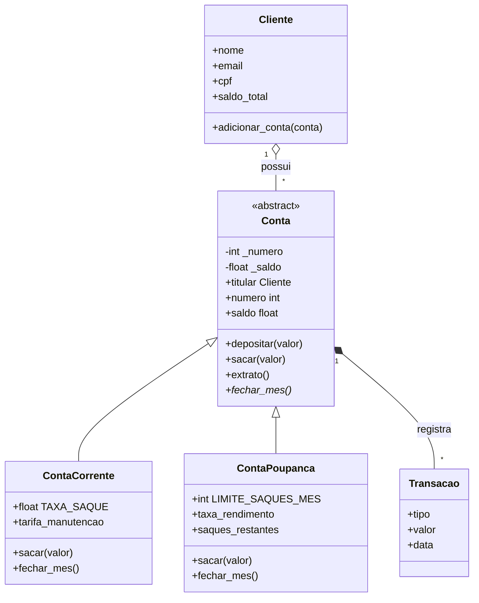
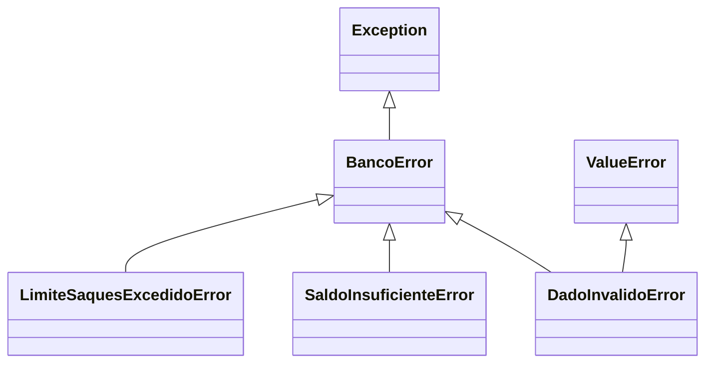

# Sistema Bancário Orientado a Objetos — Sprint 6

Projeto da disciplina **Desenvolvimento em Python**, do CEUMA (2026.2), sobre Programação Orientada a Objetos (POO).

O sistema simula um banco em que clientes possuem contas correntes e poupanças, e cada conta mantém seu histórico de transações. O projeto aplica classes, encapsulamento, herança, polimorfismo, classes abstratas, métodos especiais e tratamento de exceções.

A principal ideia é garantir que as regras de negócio sejam respeitadas desde a criação dos objetos, evitando dados inválidos.

## Estrutura do projeto

| Arquivo | Descrição |
|---|---|
| `modelagem_classes.py` | Classes, validações, exceções personalizadas e regras bancárias. |
| `testes_demonstracao.py` | Demonstração com 11 objetos, polimorfismo e tratamento de erros. |
| `testes_automatizados.py` | 22 testes automatizados usando `unittest`. |
| `README.md` | Documentação do projeto. |

As classes implementam os construtores, `__str__`, propriedades, herança, `super()`, polimorfismo e métodos especiais. A tabela de conformidade ao final relaciona cada requisito à sua implementação.

## Como executar

Requer Python 3.8 ou superior, sem bibliotecas externas.

```bash
# Executar a demonstração
python testes_demonstracao.py

# Executar os testes automatizados
python -m unittest -v testes_automatizados
```

## Diagrama de classes



### Hierarquia das exceções



**Legenda:** `<|--` representa herança, `o--` representa agregação, `*--` representa composição e `*` indica um método abstrato.

## Decisões de modelagem

A modelagem foi feita identificando os substantivos do enunciado como classes e os verbos como métodos. Assim, cliente, conta e transação viraram classes, enquanto depositar, sacar, fechar o mês e emitir extrato viraram métodos.

| Relação ou decisão | Justificativa |
|---|---|
| `ContaCorrente` e `ContaPoupanca` herdam de `Conta` | Ambas são contas e compartilham atributos e operações. |
| `Cliente` possui contas | Um cliente não é uma conta. Por isso, as contas são associadas ao cliente, sem herança entre eles. |
| `Conta` registra `Transacao` | A transação faz parte do histórico da conta que a registrou. |
| `Conta` é abstrata | Não deve existir uma conta genérica. Toda subclasse precisa implementar `fechar_mes()`. |
| `Cliente` não herda de `Conta` | Isso permite criar tipos especializados de clientes sem misturar suas responsabilidades com as contas. |

Outras decisões importantes:

- **Saldo protegido:** não possui setter. Só pode ser alterado pelas operações da conta, mantendo o histórico e impedindo saldo negativo.
- **Listas independentes:** cada conta cria seu próprio histórico no construtor, evitando o compartilhamento acidental de listas entre objetos.
- **Numeração única:** `_proximo_numero` é um atributo de classe compartilhado pelas contas.
- **Valores monetários:** são tratados com `float` e arredondados para duas casas decimais. Em sistemas financeiros reais, seria mais adequado usar `decimal.Decimal`.

## Validações com `@property`

As propriedades validam os dados tanto na criação quanto nas alterações permitidas.

| Classe | Propriedade | Regra |
|---|---|---|
| `Cliente` | `nome` | Texto com pelo menos 2 caracteres. |
| `Cliente` | `email` | Deve corresponder ao formato de e-mail definido pela regex. |
| `Cliente` | `cpf` | Formato `000.000.000-00`; somente leitura. |
| `Conta` | `saldo` | Somente leitura; não pode ficar negativo. |
| `ContaCorrente` | `tarifa_manutencao` | Número maior ou igual a zero. |
| `ContaPoupanca` | `taxa_rendimento` | Número entre 0 e 0,05 (até 5% ao mês). |
| `Transacao` | `tipo` e `valor` | Tipo conhecido e valor maior que zero. |

As validações usam `DadoInvalidoError` quando os dados não atendem às regras. A tentativa de alterar diretamente o saldo gera `AttributeError`, pois a propriedade não possui setter.

A função `validar_valor_monetario` rejeita textos, valores booleanos, `NaN`, infinito e valores que não respeitam as regras monetárias.

### Expressões regulares utilizadas

| Campo | Padrão |
|---|---|
| E-mail | `^[\w\.-]+@[\w\.-]+\.\w+$` |
| CPF | `^\d{3}\.\d{3}\.\d{3}-\d{2}$` |

**Limitação conhecida:** o CPF é validado apenas pelo formato, sem conferir os dígitos verificadores.

## Herança e polimorfismo

A classe abstrata `Conta` reúne as operações comuns. As classes `ContaCorrente` e `ContaPoupanca` reutilizam essa estrutura com `super()` e implementam suas próprias regras.

| Operação | Conta corrente | Conta poupança |
|---|---|---|
| `sacar(valor)` | Cobra o valor solicitado mais R$ 2,50 de taxa. | Permite até 3 saques por mês. |
| `fechar_mes()` | Cobra a tarifa de manutenção. | Credita o rendimento mensal. |
| `__str__()` | Exibe a tarifa mensal. | Exibe o rendimento e os saques restantes. |

O polimorfismo permite executar a mesma operação em diferentes tipos de conta sem precisar verificar sua classe:

```python
for conta in contas:
    variacao = conta.fechar_mes()
```

Cada conta executa sua própria versão de `fechar_mes()`.

## Métodos especiais

| Método | Uso |
|---|---|
| `__init__` | Cria e valida os objetos. |
| `__str__` | Apresenta os dados de forma amigável. |
| `__repr__` | Fornece uma representação técnica do objeto. |
| `__eq__` | Compara contas pelo número e clientes pelo CPF. |
| `__hash__` | Permite usar objetos em conjuntos e dicionários, respeitando a igualdade. |
| `__lt__` | Permite ordenar contas pelo saldo e clientes pelo nome. |

Nas comparações com tipos incompatíveis, os métodos retornam `NotImplemented`, seguindo o protocolo do Python.

## Exemplo de uso

```python
from modelagem_classes import (
    Cliente,
    ContaCorrente,
    ContaPoupanca,
    SaldoInsuficienteError
)

ana = Cliente("Ana Silva", "ana@email.com", "123.456.789-00")

corrente = ContaCorrente(ana, saldo_inicial=1000)
poupanca = ContaPoupanca(
    ana,
    saldo_inicial=5000,
    taxa_rendimento=0.006
)

ana.adicionar_conta(corrente)
ana.adicionar_conta(poupanca)

corrente.depositar(500)
corrente.sacar(200)  # Cobra também a taxa de R$ 2,50

print(corrente.extrato())

try:
    corrente.sacar(999999)
except SaldoInsuficienteError as erro:
    print(erro)

# Erro: saldo não pode ser alterado diretamente
# corrente.saldo = 1000000

# Erro: e-mail inválido
# Cliente("Eli", "email-invalido", "123.456.789-00")
```

## Demonstração e testes

O arquivo `testes_demonstracao.py` cria **11 objetos: 4 clientes e 7 contas**. Ele demonstra as operações bancárias, os extratos, o polimorfismo, as comparações, a ordenação e o tratamento de entradas inválidas.

A demonstração também verifica situações como:

- E-mail, CPF e nome inválidos.
- Depósito negativo ou com texto.
- Saque acima do saldo disponível.
- Tentativa de alterar o saldo diretamente.
- Saldo inicial e tarifa negativos.
- Taxa de rendimento acima do limite.
- Titular que não é um `Cliente`.
- Tentativa de instanciar a classe abstrata `Conta`.
- Tipo de transação desconhecido.
- Conta de titular diferente.
- Excesso de saques na poupança.

O arquivo `testes_automatizados.py` complementa a demonstração com **22 testes usando `unittest`**.

## Conformidade com o enunciado

| Requisito | Implementação |
|---|---|
| Pelo menos 4 classes e uma abstrata | `Conta`, `ContaCorrente`, `ContaPoupanca`, `Cliente` e `Transacao`. |
| `__init__` e `__str__` | Implementados nas classes de domínio. |
| `@property` com validações | Propriedades descritas na tabela de validações. |
| Herança e `super()` | Utilizados nas classes de conta. |
| Polimorfismo | Sobrescrita de `sacar()`, `fechar_mes()` e `__str__()`. |
| Métodos especiais | `__repr__`, `__eq__`, `__hash__` e `__lt__`. |
| Pelo menos 10 instâncias | Demonstração com 11 objetos. |
| Polimorfismo e tratamento de exceções | Demonstrados em `testes_demonstracao.py`. |
| README com diagramas e justificativas | Este documento. |

## Boas práticas aplicadas

- `PascalCase` para classes e `snake_case` para métodos e variáveis, seguindo a PEP 8.
- Docstrings para documentar classes e métodos.
- Exceções específicas, evitando `except:` genérico.
- Validação na criação e nas alterações permitidas.
- Separação entre modelagem, demonstração e testes automatizados.

O resultado é um sistema bancário de estudo que aplica os principais conceitos de POO em Python, com foco em organização, reutilização de código e consistência dos dados.
